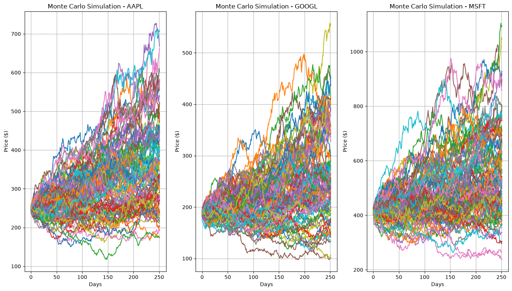

# Market Analysis Project

<p align="center">
  
</p>

This project analyzes the price behavior of three major technology stocks — Apple (AAPL), Google (GOOGL), and Microsoft (MSFT) — over the period from January 1, 2020, to December 31, 2024.

<br>

## Contents

- `analysis.ipynb`: Complete Python code for data loading, return calculation, correlation analysis, and Monte Carlo simulation.
- `stock_data.csv`: Daily price data for the three companies.
- `report.md`: Full project report (English).
- `requirements.txt`: List of required Python libraries.

<br>

## How to Run

1. Install the required libraries :
   ```bash
   pip install -r requirements.txt
2. Open `analysis.ipynb` in Jupyter Notebook or VS Code.

3. Run all cells sequentially.

<br>

## Data Source

Historical stock price data were obtained from Yahoo Finance via the `yfinance` library.

<br>

## Author
`Mobin Salou`
